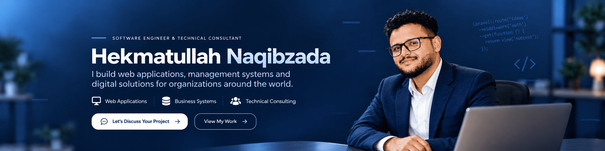

  

   

  

    
    
    
  

  

## 👋 About Me

I'm **Hekmatullah Naqibzada**, a software engineer, full-stack developer, and database professional based in **Kabul, Afghanistan**.

With **8+ years of professional experience (2018–present)**, I build practical, maintainable digital solutions—from organizational websites and customer-facing applications to complex, database-driven management systems. My experience includes work with **NGOs, consulting firms, businesses, and international teams** across Afghanistan, New Zealand, the United Kingdom, and the United States.

I enjoy connecting business requirements with reliable engineering: understanding the problem, designing the data model, developing the application, and supporting it after launch.

- 💼 **Core work:** Enterprise systems, web applications, REST APIs, and database engineering
- 🧩 **Approach:** Clear architecture, usable interfaces, maintainable code, and long-term support
- 🌍 **Collaboration:** Remote teams, international clients, and cross-functional stakeholders
- 🤝 **Availability:** Open to relevant remote opportunities, freelance projects, and technical collaborations

> **My goal:** Turn complex business needs into software that people can depend on.

## 🛠️ What I Work On

| Area | What I Deliver |
| --- | --- |
| **Enterprise & Management Systems** | HR and payroll, student and staff management, workflows, reporting, and operational platforms |
| **Full-Stack Web Applications** | Custom applications with responsive frontends, reliable backends, and role-based access |
| **API & Backend Development** | REST APIs, third-party integrations, authentication, and business logic |
| **Database Engineering** | Schema design, complex queries, data integrity, optimization, and reporting |
| **Business Websites & Portals** | Dynamic corporate websites, client portals, administrative dashboards, and content platforms |
| **Delivery & Maintenance** | Deployment support, troubleshooting, enhancement, and long-term maintenance |

## 💻 Technology Stack

  
  
  
  
  
  

| Category | Technologies & Tools |
| --- | --- |
| **Backend** | PHP, Laravel, REST APIs, Livewire, Node.js, MVC architecture |
| **Frontend** | React, JavaScript, TypeScript, HTML5, CSS3, Tailwind CSS, Bootstrap, Vue.js, jQuery, AJAX |
| **Databases** | MySQL, MariaDB, Microsoft SQL Server, relational database design and query optimization |
| **Development & Delivery** | Git, GitHub, Docker, Linux, Postman, Vite, Composer, npm |

## 🌍 Selected Projects, Products & Client Work

These projects reflect work I have delivered or contributed to through personal initiatives, direct engagements, and professional teams. The links lead to **public websites of the respective organizations**; internal management systems and private source repositories may not be publicly accessible. Project-specific implementation details are intentionally omitted.

| Project | Overview | Website |
| --- | --- | --- |
| **ANAFAE — Afghanistan** | Organizational website with dynamic information, programs, news, and public engagement | [Visit ANAFAE](https://anafae.af/) |
| **OJWA — Afghanistan** | Responsive nonprofit digital platform for organizational information, programs, and public engagement | [Visit OJWA](https://ojwa.org/) |
| **PAKTAS — United Kingdom** | Translation and interpreting services platform with client, booking, and operational workflows | [Visit PAKTAS](https://paktas.co.uk/) |
| **Composting NZ — New Zealand** | Full-stack online store for compost, soils, mulches, and landscaping supplies, with product catalogs, checkout, shipping, and administration workflows | [Visit Composting NZ](https://compostingnz.co.nz/) |
| **Gulab Tahir Group — Afghanistan** | Corporate website with dynamic content management and a modern interface | [Visit Gulab Tahir Group](https://gulabtahirgroup.com/) |
| **NEXI-US Digital Hub — United States** | Company web presence and digital business platform | [Visit NEXI-US](https://nexi-us.com/) |
| **EggShell — United States** | Career-focused education website featuring training programs and admissions information | [Visit EggShell](https://eggshellc.com/) |
| **Khurasan Digital — Afghanistan** | Software and digital services company website showcasing solutions and service offerings | [Visit Khurasan Digital](https://khurasandigital.com/) |
| **SkillUp Consultancy Services — Afghanistan** | Consultancy website and digital business platform | [Visit SkillUp](https://skillup-af.com/) |
| **AECA — New Zealand** | Public-facing community organization website | [Visit AECA](https://aeca.org.nz/) |
| **SportZone — New Zealand** | Football club, registration, and sports-management platform | [Visit SportZone](https://sportzone.org.nz/) |
| **AWMIS — Afghan Writer** | Internal translation operations system covering projects, clients, translators, and administrative workflows | [Visit Afghan Writer](https://afghanlikwal.com/) |

**A note about client work:** Some projects were delivered in collaboration with agencies or development teams. Public-facing websites are linked for reference; the presence of a website here does not mean its entire current codebase or all modules were developed exclusively by me.

### 🔐 Private Education & Enterprise Platforms

The following systems are not publicly linked to protect organizational access and privacy. Their functional scope is described only at a high level.

| Project | Overview | Public Access |
| --- | --- | --- |
| **Second Chance Education — Online Learning Platform** | Online education platform supporting student access, virtual classes, and attendance workflows | **Private — no public link** |
| **ANAFAE — HR & Payroll MIS** | Internal human resources and payroll management, including staff records, timesheets, salary processing, and reporting | **Private — no public link** |
| **Task Management System** | Internal task assignment, team collaboration, progress tracking, and workflow coordination | **Private — no public link** |

### 🔒 Experience Beyond Public Repositories

Much of my professional work involves **private repositories and internal systems** that cannot be shared openly. Examples of the problems I have worked on include:

- HR, attendance, payroll, and employee administration
- Student registration, enrollment, and education management
- Translation orders, translator workflows, and business operations
- Reporting, approval workflows, relational data, and API integration

For additional project details and background, explore my [personal portfolio](https://hekmatnaqibzada.com).

## 📈 GitHub Activity

  

> **Note:** My public contribution history does not represent all professional development work, because many client and employer repositories are private.
## 🎓 Education

**Bachelor of Computer Science (Database & Programming)**  
Allamah Institute of Higher Education, Afghanistan

## 🤝 Let's Build Something Useful

Whether you need a reliable management system, a custom web application, an API integration, or a developer who understands both business processes and implementation, I'd be happy to connect.

  
  

  
<strong>Engineering dependable solutions for real-world challenges.</strong>

